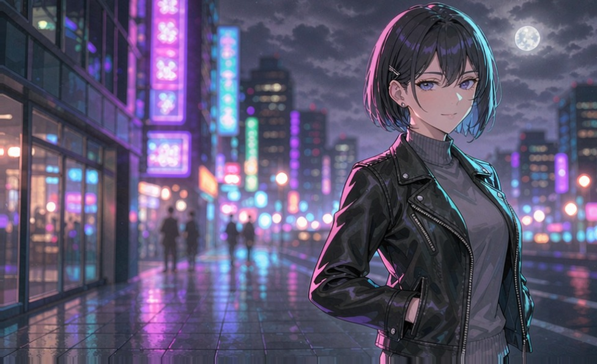

# 光栅背屏·海风五景（Lenticular Rear）

小米 17 Pro / 17 Pro Max 妙享背屏用的「光栅」壁纸：**倾斜手机时在 5 张图之间平滑翻页**（碧海·蓝发 / 粉发 / 黄昏狐耳 / 白发青 / 黑发黄昏），叠加竖向光栅条纹与轻微视差。

## 特性
- 5 张图随倾斜（orientation.roll）平滑交叉翻页，不自动摆动
- 息屏(AOD)仍显示图片（轻微压暗）
- 适配背屏 976×596（对摄像头挖孔区域做 overscan 铺满）
- 依赖 REAREye（LSPosed / Xposed），通过 REAREye 壁纸管理器导入

## 安装
1. 在 REAREye → 壁纸管理器 → 导入 MRC / ZIP 壁纸包
2. 选择 Release 里的 `Lenticular-Rear-5.mrc`（或 `.zip`）
3. 设为当前壁纸

## 说明
- 仅供学习交流；角色素材版权归原作者，请勿商用。
